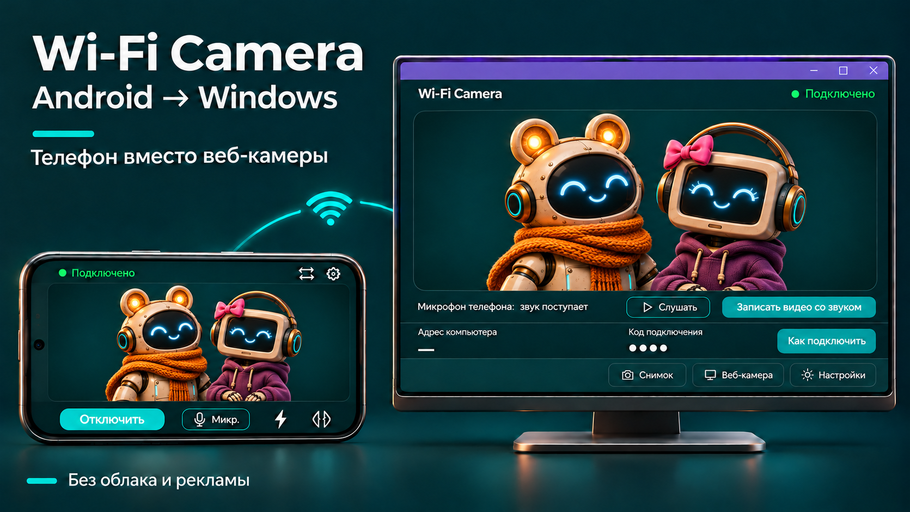
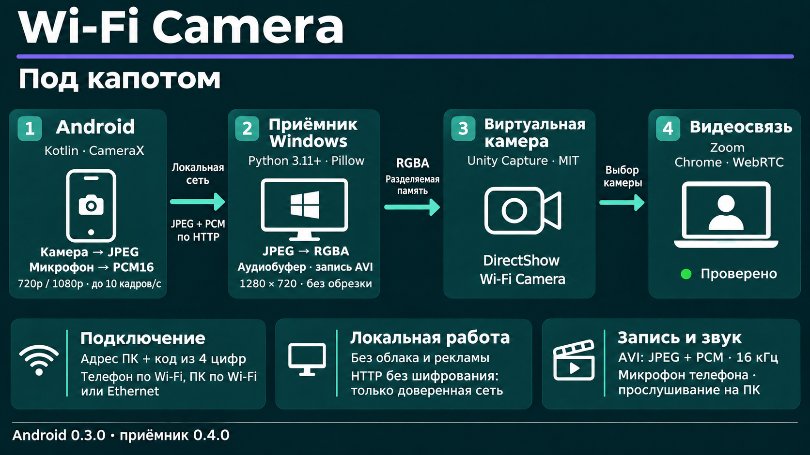

# Wi-Fi Camera · Android → Windows

**Автор: Диана Кокорева · [medvejka.ru](https://medvejka.ru)**

[Быстрый старт](QUICKSTART.md) · [Результаты проверок](VERIFICATION.md)

Приёмник 0.4.0, Android 0.3.0. Телефон передаёт JPEG по локальному Wi-Fi,
приёмник выводит кадры в обычную виртуальную камеру **Wi-Fi Camera**.
OBS и Unity запускать или настраивать не нужно. Облака и рекламы нет.

## Установка и запуск

1. Распаковать приёмник в постоянную папку на диске D: или F:. Нужны Windows 10/11 x64,
   установленный Python 3.11+ x64. Панель открывается отдельным окном Microsoft Edge;
   если Edge отсутствует — вкладкой браузера по умолчанию.
2. Один раз запустить windows/setup.cmd. Он создаёт локальное окружение Python,
   устанавливает Pillow и запрашивает повышение прав для регистрации камеры.
   Кэши, окружение и DLL остаются рядом с проектом на диске.
3. Запустить windows/start.cmd. Ярлык для этой команды можно создать вручную.

4. Установить outputs/WifiCamera-debug.apk на Android 8.0+. Открыть приложение,
   разрешить камеру, нажать «Подключиться», ввести адрес ПК и четыре цифры кода.
   ПК может быть подключён Ethernet-кабелем, телефон — Wi-Fi того же роутера.
5. В Zoom или настройках камеры сайта выбрать **Wi-Fi Camera**.
   После первой установки перезапустить программу/браузер для обновления списка.
   Разрешение сайта на доступ к камере пользователь подтверждает в браузере.

### Как используется браузер

Браузер отображает только локальную панель управления: предпросмотр, код подключения,
снимки, прослушивание и запись. В Edge она открывается отдельным окном без обычной
адресной строки. Адрес 127.0.0.1 относится к этому же компьютеру; это локальный
интерфейс, а не облачный сайт. Закрытие панели останавливает прослушивание в окне,
но приёмник, виртуальная камера и начатая запись продолжают работать.

Для звонка в установленном Zoom браузерная панель не обязательна: достаточно
работающего приёмника, подключённого телефона и выбора камеры Wi-Fi Camera в Zoom.
Если конференция проходит на сайте, доступ к виртуальной камере разрешается
самому сайту. Получение живого видео проверено в Chrome через getUserMedia;
другие браузеры и конкретные сайты конференций отдельно не проверялись.

На телефоне: касание видео включает/выключает полный экран в любой ориентации,
удержание фокусирует, два пальца меняют масштаб (если камера поддерживает).
Передняя/задняя камеры, зеркало, фонарь при наличии вспышки, качество и разрешение
настраиваются на телефоне. Адрес и обычные настройки сохраняются, код — только в памяти.
Уход приложения в фон останавливает передачу. Разрешение источника до 1080p,
передача до 10 кадров/с. Выход Windows стабилен: 1280×720 с полями без обрезки.
Для выбранного приложением другого разрешения компонент масштабирует изображение.

Приёмник должен оставаться запущенным во время звонка. Его окно доступно на
http://127.0.0.1:8765/app. Закрытие окна оставляет передачу работающей;
для полной остановки — «Настройки → Завершить приёмник».
Снимки делаются только по кнопке, в user-data/captures. Запись видео со звуком доступна отдельно по кнопке; порядок ниже.
После потери связи более двух секунд старый кадр заменяется экраном ожидания.
В Zoom можно оставить свои наушники/компьютерный микрофон. Звук телефона доступен для прослушивания и записи внутри нашего приложения; отдельный виртуальный микрофон Windows не устанавливается.

## Микрофон и запись видео со звуком

1. Подключи телефон. Нажми «Микр.» внизу Android-приложения и разреши доступ
   к микрофону. По умолчанию он выключен, в фоне не работает; новое подключение
   также начинается без микрофона. Видео продолжает работать при отказе в разрешении.
2. На ПК появится «Микрофон телефона: звук поступает». «Слушать» включает звук
   только в этом окне браузера/Edge. Повторное нажатие выключает его.
   Для прослушивания используй наушники, чтобы избежать акустической обратной связи.
   Закрытие окна прекращает прослушивание, но не останавливает приёмник или запись.
3. «Записать видео со звуком» начинает локальную запись, «Остановить запись»
   завершает файл. Запись доступна при живом видео и поступающем звуке телефона.
   Путь: user-data/recordings; он показан в настройках. Ничего не записывается
   автоматически. Кнопка «Снимок» по-прежнему сохраняет отдельный JPEG.
4. Формат AVI: Motion JPEG, 1280 × 720, 10 кадров/с, PCM16 mono 16 кГц.
   Пропорции сохраняются с полями. MP4 не создаётся; новые кодеки не требуются.
   В Windows нужен проигрыватель с поддержкой MJPEG/PCM AVI. Файл ограничен 1 ГиБ;
   при достижении предела запись завершается с сообщением. Для продолжения начни новый.
5. При потере видео более двух секунд запись автоматически завершается. Если
   выключить только микрофон, видео продолжит записываться, а пропуски звука
   заполнятся тишиной. Штатное завершение приёмника закрывает AVI; аварийное
   убийство процесса или отключение питания может оставить незавершённый файл.

Аудио идёт отдельными аутентифицированными HTTP-запросами PCM; первые видео-кадры
устанавливают сессию. Видео и звук используют временные метки, короткие ограниченные
буферы и общий таймлайн записи. Разрешения и выключение микрофона независимы от
камеры. Через Unity Capture проходит только изображение. Это не виртуальный
микрофон для конференций: текущую схему с наушниками в Zoom менять не нужно.

## Компонент камеры

Используется неизменённый MIT DirectShow-фильтр Unity Capture, закреплённый commit
3ed54c325e0ad71afcf4f246c07e5e17b3d7f2d2. Это пользовательский COM-компонент,
собственный драйвер ядра не написан.
Python напрямую пишет RGBA в локальную разделяемую память по открытому протоколу.
DLL 32/64 бит, лицензия и происхождение находятся в windows/camera-component.
Установщик проверяет SHA256 и не перезаписывает чужую установку Unity Capture.
Компонент камеры обязательно устанавливается один раз.
Перед переносом/удалением зарегистрированных DLL выполнить от администратора:
`powershell -NoProfile -ExecutionPolicy Bypass -File windows/install-camera.ps1 -Uninstall`.
Затем установить компонент из новой постоянной папки.

## Безопасность и ограничения

HTTP без шифрования, только доверенная частная сеть. Четырёхзначный код;
после пяти ошибок блокировка на минуту, первый успешный отправитель привязывается
по IP. Просмотр, управление, снимки доступны только с loopback и проверкой Host.
Порты роутера наружу не открывать, брандмауэр не отключать. Не хранить ключи,
личные снимки и настройки клиента в поставляемом шаблоне.
Нет облака, рекламы, USB-видео и фоновой камеры/микрофона Android.
Автозапуск Windows, автопоиск телефона, трей и управление камерой с ПК не добавлены.
APK отладочный; для поставки нужен постоянный ключ подписи поставщика.

## Сборка и проверки

`build.cmd` собирает APK. Портативные JDK 17, Gradle 8.9 и Android SDK остаются
в work/toolchain на D:. scripts/setup-tools.ps1 воспроизводит загрузку;
scripts/build.ps1 направляет рабочие каталоги/кэши на D: и запускает сборку/lint.
Для Windows: `py -3 -B -m unittest discover -s windows -v`.
Независимая проверка AVI через PyAV опциональна: без него один тест пропускается;
на этой машине он установлен только в work/av-verification, в поставку не входит.
Проверка Node страницы выполняется штатно из этого теста, не пустым запуском JS.
`py -3 -B scripts/package.py` упаковывает исходники и приёмник, включая лицензии
и DLL; исключает кэши, окружения, user-data, SDK и ключи подписи.

Фактические результаты: [VERIFICATION.md](VERIFICATION.md) и числовые отчёты
в [docs/verification](docs/verification). Zoom без OBS подтверждён
пользователем; DirectShow и WebRTC в Chrome проверены захватом живых кадров.
Совместимость абсолютно со всеми приложениями, Windows Camera/UWP, длительная
нагрузка, параллельные клиенты и другие компьютеры не подтверждены.

## Первичные источники

- https://github.com/schellingb/UnityCapture (фильтр, регистрация, лицензия)
- https://learn.microsoft.com/en-us/windows/win32/api/mfvirtualcamera/nf-mfvirtualcamera-mfcreatevirtualcamera
  (новый API Microsoft требует Windows build 22000 и выше)
- https://www.e2esoft.com/ivcam/ (ориентир интерфейса, без копирования брендинга)

## Архитектура

Видео: Android CameraX → JPEG по локальному HTTP → Python/Pillow → RGBA в
разделяемой памяти → Unity Capture / DirectShow → Wi-Fi Camera в приложениях.
Звук: Android AudioRecord → PCM по HTTP → буфер приёмника → прослушивание в панели
или запись AVI вместе с видео. Через виртуальную камеру проходит только видео.

## Структура репозитория

- `android/` — приложение телефона и Gradle Wrapper.
- `windows/` — приёмник, панель, AVI-запись, компонент камеры и тесты.
- `scripts/` — воспроизводимые загрузка инструментов, сборка и упаковка.
- `docs/` — иллюстрации и числовые отчёты проверок.
- `QUICKSTART.md`, `VERIFICATION.md` — запуск и границы проверенного.

`work/`, `outputs/`, личные снимки, записи, настройки, ключи и локальные пути SDK
исключены из Git. Не сохраняй в исходниках реальные адреса и коды подключения.

## Права и сторонние компоненты

Для собственного кода проекта отдельная открытая лицензия пока не назначена.
Публичный доступ к исходникам сам по себе не является разрешением на их
перепродажу или использование в стороннем продукте. Условия можно согласовать
с автором через [medvejka.ru](https://medvejka.ru).

Unity Capture распространяется по MIT; его лицензия и происхождение находятся
в [windows/camera-component](windows/camera-component). Лицензии сторонних
компонентов сохраняют силу.
